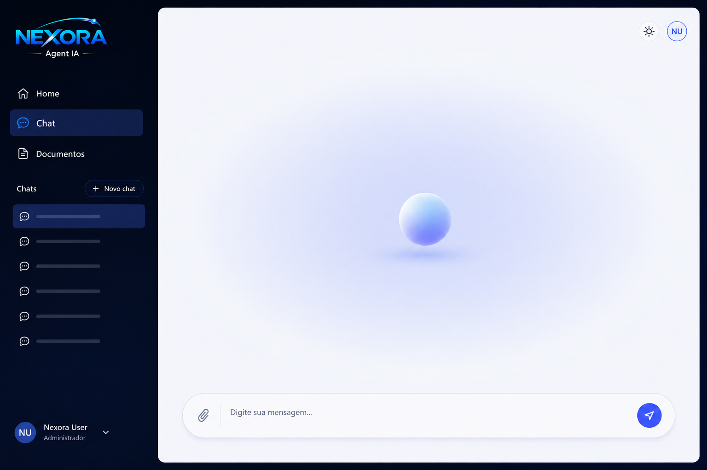
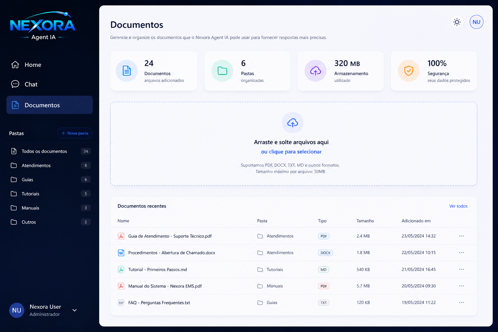

# SuportIA

SuportIA é um agente de suporte técnico inteligente para os softwares **Home** e **Stella**, da Data C. A aplicação combina uma base de conhecimento privada com modelos da OpenAI para diagnosticar erros operacionais, falhas do sistema e rejeições fiscais (SEFAZ).

O agente consulta primeiro os documentos e atendimentos indexados do próprio usuário. Quando não encontra contexto interno suficiente, solicita consentimento explícito antes de pesquisar fontes externas.



## Funcionalidades

- Atendimento por texto ou imagem, com extração de informações de capturas de tela.
- Busca semântica em documentos com RAG e embeddings da OpenAI.
- Bases separadas por usuário e por software, evitando acesso cruzado a documentos.
- Upload assíncrono de arquivos PDF, DOCX, TXT e Markdown de até 20 MB.
- Identificação de arquivos que precisam de OCR e opção de tentar o processamento novamente.
- Pesquisa externa somente após autorização explícita do usuário.
- Histórico de conversas protegido por sessão e autorização por proprietário.
- Exportação de atendimentos para PDF e indexação dos PDFs exportados.
- Configuração do primeiro usuário diretamente pela tela inicial.



## Tecnologias

- PHP 8.3+ e Laravel 13
- Vue 3, Vue Router, Tailwind CSS 4 e Vite 8
- MySQL 9 com armazenamento vetorial nativo quando disponível e cálculo de similaridade em PHP quando `VECTOR_DISTANCE` não estiver disponível
- OpenAI para chat, visão, embeddings e pesquisa externa
- Filas do Laravel para extração e indexação de documentos
- Pest 4 para testes automatizados
- Docker Compose com PHP-FPM, Nginx, MySQL e worker de fila

## Como funciona

1. A mensagem e a imagem opcional são validadas e armazenadas no histórico.
2. Imagens são analisadas pelo modelo de visão para complementar a pergunta.
3. O `VectorSearchService` busca trechos relevantes entre documentos indexados do usuário e filtrados pelo software da conversa.
4. Quando há resultados relevantes, o contexto é incorporado ao prompt do agente.
5. Sem contexto interno suficiente, o agente pede permissão para pesquisar na web.
6. Com o consentimento, a pesquisa externa é executada e a resposta é adicionada ao atendimento.

O comportamento do agente é definido em [`prompt/AgenteIA.md`](prompt/AgenteIA.md), e a visão técnica original está em [`prompt/Estructure.md`](prompt/Estructure.md).

## Requisitos

Para execução local:

- PHP 8.3 ou superior com `pdo_mysql`, `mbstring`, `xml`/`dom` e `zip`
- Composer 2
- Node.js 20+ e npm
- MySQL
- Chave de API da OpenAI

Como alternativa, Docker e Docker Compose fornecem todo o ambiente de execução.

## Instalação local

1. Instale as dependências e crie o arquivo de ambiente:

   ```bash
   composer install
   npm install
   cp .env.example .env
   php artisan key:generate
   ```

2. Configure o banco e a OpenAI no `.env`:

   ```dotenv
   APP_NAME=SuportIA
   APP_URL=http://localhost:8000

   DB_CONNECTION=mysql
   DB_HOST=127.0.0.1
   DB_PORT=3306
   DB_DATABASE=suportia
   DB_USERNAME=root
   DB_PASSWORD=

   OPENAI_API_KEY=
   OPENAI_MODEL=gpt-4o
   OPENAI_WEB_SEARCH_MODEL=gpt-5-search-api
   OPENAI_VISION_MODEL=gpt-4o
   OPENAI_EMBEDDINGS_MODEL=text-embedding-3-small
   OPENAI_EMBEDDINGS_DIMENSIONS=1536
   OPENAI_RAG_TOP_K=5
   OPENAI_RAG_MAX_DISTANCE=0.6
   ```

3. Prepare o banco de dados:

   ```bash
   php artisan migrate
   ```

4. Inicie o servidor, o worker de filas, os logs e o Vite:

   ```bash
   composer dev
   ```

5. Acesse [http://localhost:8000](http://localhost:8000). No primeiro acesso, cadastre o usuário administrador com uma senha de no mínimo oito caracteres.

O worker de filas deve permanecer em execução para que os documentos sejam extraídos e indexados.

## Instalação com Docker

1. Crie o arquivo de ambiente:

   ```bash
   cp .env.example .env
   ```

2. Ajuste pelo menos estas variáveis no `.env`:

   ```dotenv
   APP_NAME=SuportIA
   APP_URL=http://localhost:8005
   DB_HOST=mysql
   DB_PORT=3306
   DB_DATABASE=suportia
   DB_USERNAME=suportia
   DB_PASSWORD=123456
   OPENAI_API_KEY=
   ```

3. Construa os contêineres e prepare a aplicação:

   ```bash
   docker compose up -d --build
   docker compose exec app composer install
   docker compose exec app npm install
   docker compose exec app php artisan key:generate
   docker compose exec app php artisan migrate
   docker compose exec app npm run build
   ```

4. Acesse [http://localhost:8005](http://localhost:8005).

Os serviços criados são `app`, `queue`, `nginx` e `mysql`. O banco é persistido no volume `mysql_data`.

## Variáveis da IA

| Variável | Finalidade | Padrão |
|---|---|---|
| `OPENAI_API_KEY` | Credencial da API da OpenAI | — |
| `OPENAI_ORGANIZATION` | Organização da OpenAI, quando aplicável | — |
| `OPENAI_MODEL` | Modelo principal do agente | `gpt-4o` |
| `OPENAI_WEB_SEARCH_MODEL` | Modelo usado na pesquisa externa | `gpt-5-search-api` |
| `OPENAI_VISION_MODEL` | Modelo usado para analisar imagens | `gpt-4o` |
| `OPENAI_EMBEDDINGS_MODEL` | Modelo de embeddings | `text-embedding-3-small` |
| `OPENAI_EMBEDDINGS_DIMENSIONS` | Dimensão dos vetores armazenados | `1536` |
| `OPENAI_RAG_TOP_K` | Quantidade máxima de trechos recuperados | `5` |
| `OPENAI_RAG_MAX_DISTANCE` | Distância máxima aceita na busca semântica | `0.6` |

Alterar o modelo ou a dimensão dos embeddings exige reindexar os documentos existentes para manter os vetores compatíveis.

## API

As rotas de negócio exigem uma sessão autenticada. As principais rotas são:

| Método | Rota | Descrição |
|---|---|---|
| `GET` | `/api/setup/status` | Informa se o primeiro usuário precisa ser criado |
| `POST` | `/api/setup` | Cria e autentica o primeiro usuário |
| `POST` | `/api/login` | Inicia uma sessão |
| `POST` | `/api/logout` | Encerra a sessão |
| `GET` | `/api/chats` | Lista as conversas do usuário |
| `POST` | `/api/chats` | Cria uma conversa para Home ou Stella |
| `GET` | `/api/chats/{chat}` | Retorna a conversa e as mensagens recentes |
| `POST` | `/api/chats/{chat}/messages` | Envia texto, imagem ou consentimento de busca |
| `GET` | `/api/chats/{chat}/messages/{message}/attachment` | Baixa o anexo de uma mensagem |
| `POST` | `/api/chats/{chat}/export-pdf` | Exporta e agenda a indexação da conversa |
| `DELETE` | `/api/chats/{chat}` | Exclui a conversa e seus documentos |
| `GET` | `/api/knowledge-bases` | Lista documentos da base de conhecimento |
| `POST` | `/api/knowledge-bases` | Envia um documento para processamento |
| `POST` | `/api/knowledge-bases/{document}/retry` | Tenta processar novamente um documento |
| `DELETE` | `/api/knowledge-bases/{document}` | Exclui o documento e seus índices |
| `GET` | `/api/documents` | Lista PDFs exportados das conversas |
| `GET` | `/api/documents/{document}/download` | Baixa um PDF exportado |
| `POST` | `/api/documents/{document}/retry` | Indexa novamente uma conversa exportada |
| `DELETE` | `/api/documents/{document}` | Exclui um documento exportado |

O envio de mensagens aceita `message`, `image`, `external_search_consent`, `external_search_declined` e `client_message_id`. Imagens podem ser JPG, PNG ou WebP, com até 10 MB.

## Testes e qualidade

Execute a suíte completa:

```bash
composer test
```

Formate o código PHP com:

```bash
./vendor/bin/pint
```

Gere o bundle de produção com:

```bash
npm run build
```

## Estrutura principal

```text
app/
├── AI/                         # Agente, prompts, embeddings e ferramentas
├── Http/Controllers/Api/       # Autenticação, chats e documentos
├── Jobs/                       # Processamento assíncrono de documentos
├── Models/                     # Usuários, chats, mensagens e documentos
└── Services/
    ├── AI/                     # Integração com os modelos
    ├── Search/                 # Busca vetorial e pesquisa externa
    ├── Vision/                 # Análise de imagens
    ├── ChatToPdfExporter.php
    └── DocumentProcessor.php

resources/js/
├── Components/                 # Componentes Vue compartilhados
├── Composables/                # Estado e operações de chat/documentos
├── Pages/                      # Login, início, chat e documentos
└── Services/api.js             # Cliente HTTP da API
```

## Licença

Este projeto utiliza o framework Laravel, distribuído sob a licença [MIT](https://opensource.org/licenses/MIT).
